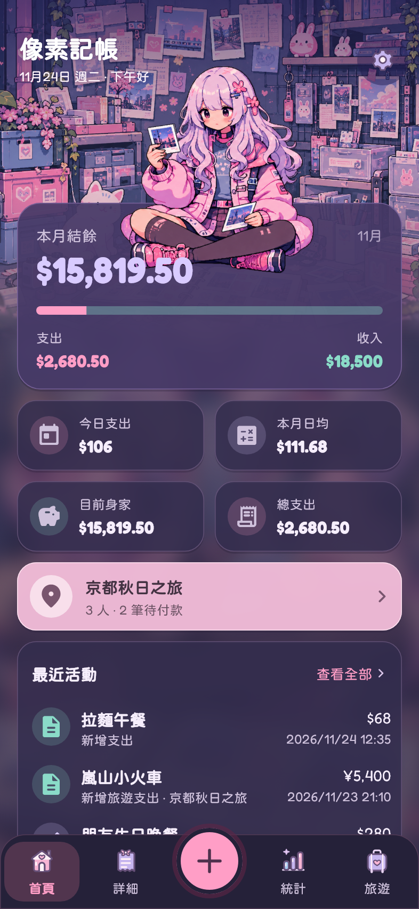
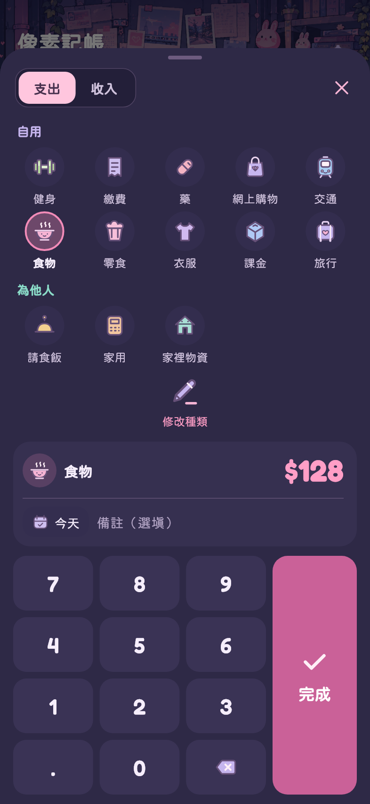
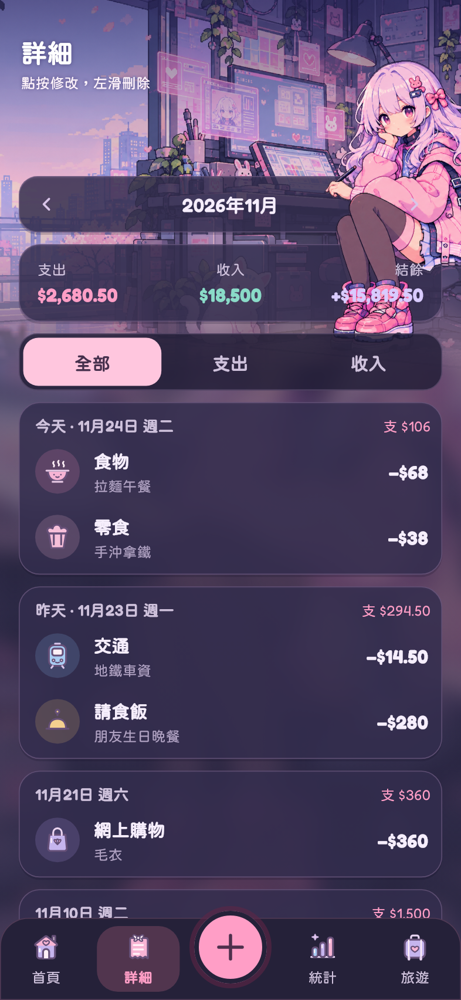
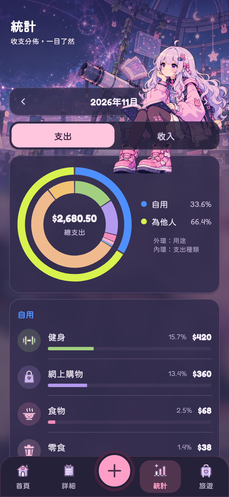
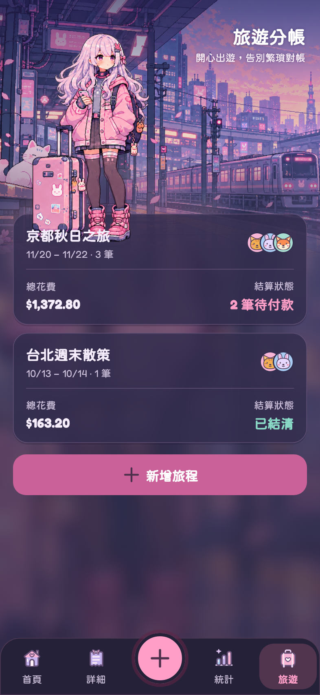
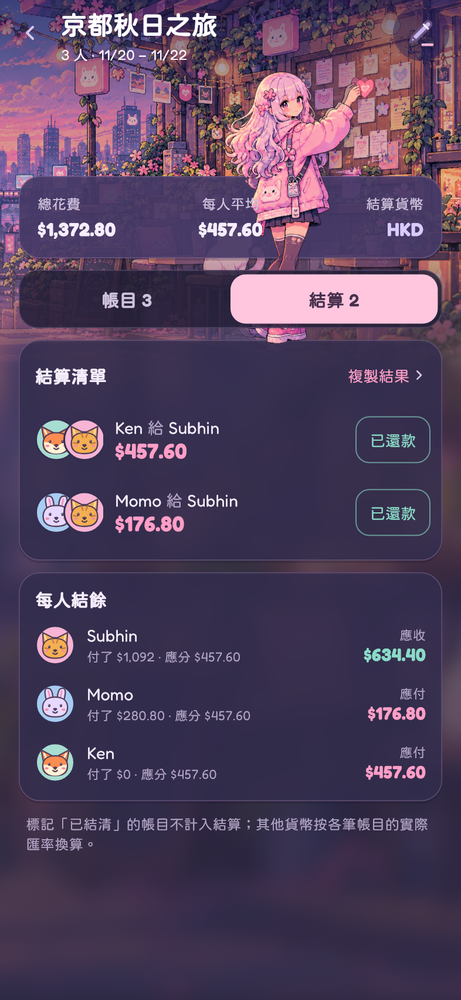

<div align="center">

# 像素記帳 / Pixel Budget

**Offline-first pixel-art personal ledger & travel bill-splitting Flutter Android app**  
**結合像素插畫場景、分層玻璃卡片與多幣別旅遊分帳的離線 Android 記帳 App**

[English](#english) · [繁體中文](#繁體中文) · [Download APK (v1.1.0)](https://github.com/subhin4078/Pixel-Budget/releases/latest)

</div>

---

## Screenshots

<table>
  <tr>
    <td align="center">
      <br />
      <sub><b>Home / 首頁總覽</b></sub>
    </td>
    <td align="center">
      <br />
      <sub><b>Quick Entry / 快捷記帳</b></sub>
    </td>
    <td align="center">
      <br />
      <sub><b>Records / 每日明細</b></sub>
    </td>
  </tr>
  <tr>
    <td align="center">
      <br />
      <sub><b>Statistics / 雙環統計</b></sub>
    </td>
    <td align="center">
      <br />
      <sub><b>Travel / 旅遊分帳</b></sub>
    </td>
    <td align="center">
      <br />
      <sub><b>Settlement / 自動結算</b></sub>
    </td>
  </tr>
</table>

---

## English

### Overview

**Pixel Budget** is an offline-first personal finance and travel expense-splitting Android app built with Flutter. It pairs bespoke pixel-art illustrations and custom pastel vector iconography with deterministic integer-cent ledger accounting and local SQLite persistence.

### Design & Visual Craft

- **Layered Pixel-Art Scene Compositing (`ScenePage` + `CardBackdropHost`)**: Six custom-illustrated scenes (`assets/backgrounds/` & `assets/foregrounds/`) rendered through a custom `RenderBox` pipeline (`lib/shared/widgets/card_backdrop.dart`) so glassmorphic card tints sit *behind* the character cutout while card typography and controls float *above* it.
- **Twilight Lavender & Pastel Palette**: Built around deep purple surfaces (`#29253F`), sakura pink accents (`#FF9EC6`), mint income indicators (`#8ADBC8`), and lavender balance highlights (`#D9CBFF`), paired with **Fredoka** numerals and **jf open 粉圓** CJK typography.
- **100 Custom Pastel SVG Icons & 15 Animal Avatars**: Hand-crafted 24×24 vector icons (`assets/icons/`) across 10 themed groups, plus custom-drawn animal badges for trip members.
- **Dual-Ring Spending Chart (`CategoryRing`)**: Custom `CustomPainter` rendering an outer ring for spending purpose (*Self* / *For Others*) and an inner ring for categories with collision-free colors.
- **Custom Keypad & Gestures**: Tactile numeric keypad (`AmountKeypad`), drag-and-drop category reordering within purpose groups, and swipe-to-delete with undo snacks.

### Features

- **Personal Ledger**: Home dashboard showing monthly balance, today's spending, daily average, all-time net worth, total spending, recent activity log, and active trip shortcut.
- **Flexible Categories**: Add, edit, hide, or drag-reorder categories within *Self* and *For Others*; remembers separate last-used categories for expense and income.
- **Records & Statistics**: Daily grouped ledger list with type filters (`All` / `Expense` / `Income`) and monthly dual-ring / single-ring breakdowns.
- **Multi-Currency Travel Splitting**: Built-in `HKD`, `JPY`, `EUR`, `CNY`, `TWD`, `USD` plus custom currencies & symbols, per-trip default rates, per-entry rate overrides, fixed + equal split apportionment, and greedy integer-cent settlement suggestions.
- **Notification Quick-Entry & CSV Backup**: Persistent Android notification shortcut bar (`Home`, `Income`, `Expense`) and streaming UTF-8 CSV export/import with duplicate detection and import preview.

### Project Structure

| Path | Purpose |
|---|---|
| `lib/app` | App bootstrap, bottom navigation shell, SQLite schema/migrations, activity log, CSV backup & Android channels |
| `lib/ledger` | Personal ledger models, calculations, validation, repository & `ChangeNotifier` controller |
| `lib/travel` | Travel splitting models, integer-cent apportionment & settlement engine, validation & controller |
| `lib/features` | Home, Records, Entry Sheet & Category Editor, Statistics, Settings & Travel pages |
| `lib/shared` | Design tokens (`app_theme.dart`), layered scene renderer, `CardBackdropHost`, charts & keypad |
| `assets` | Scene backgrounds, character foregrounds, 150+ SVGs, bundled fonts & app icon master |
| `android` | Kotlin `MainActivity`, Storage Access Framework `CsvDocuments`, `NotificationShortcuts` & launcher resources |

### Build from Source

Requirements: **Flutter 3.x** (verified with Flutter `3.47.7` / Dart `3.13.5`, SDK `>=3.7.0 <4.0.0`) and **Android SDK**.

```bash
flutter pub get
flutter analyze
flutter run
flutter build apk --release
```

To sign release builds with your own keystore, copy `android/key.properties.example` to `android/key.properties` (gitignored) and fill in your keystore credentials. If `android/key.properties` is absent, local `flutter build apk --release` falls back to Android debug signing for development convenience.

### Data Privacy & License

- **Local-First Privacy**: All data stays on-device in `pixel_budget.db` with `INTERNET` omitted from the release manifest and Android cloud backup / device-to-device transfer disabled (`allowBackup="false"` & `dataExtractionRules`). Export a UTF-8 CSV backup from Settings before uninstalling.
- **Copyright — Personal Use Only ([`LICENSE`](LICENSE))**: Copyright © 2026 subhin. All Rights Reserved. Shared publicly as a design and engineering showcase for viewing and strictly private, non-commercial personal use only. **No commercial use, sale, copying, modification, reuse, or redistribution of any code, artwork, icons, or assets in any format is permitted.**
- **Third-Party Fonts**:
  - **jf open 粉圓**: SIL Open Font License 1.1 (`assets/fonts/JfOpenHuninn-OFL.txt`; Hanzi glyphs derived from Motoya Kosugi Maru under Apache License 2.0).
  - **Fredoka**: SIL Open Font License 1.1 (`assets/fonts/Fredoka-OFL.txt`).

---

## 繁體中文

### 簡介

**像素記帳（Pixel Budget）** 是一款離線優先的 Flutter Android 個人記帳與旅遊分帳 App，結合原創像素插畫場景、粉彩 SVG 圖示與嚴謹的整數分本機記帳引擎，所有資料皆保存於裝置本機。

### 設計與視覺特色

- **分層像素插畫場景（`ScenePage` + `CardBackdropHost`）**：六組專屬繪製的場景背景與人物前景（`assets/backgrounds/`、`assets/foregrounds/`），透過自訂 `RenderBox` 繪製層級（`lib/shared/widgets/card_backdrop.dart`），讓半透明玻璃卡片底色位於人物後方，而文字與數據浮現於人物前方。
- **深紫粉彩視覺系統**：以暮光深紫（`#29253F`）、櫻花粉（`#FF9EC6`）、薄荷綠（`#8ADBC8`）與薰衣草紫（`#D9CBFF`）構成統一配色，搭配 **Fredoka** 數字字型與 **jf open 粉圓** 中文字體。
- **100 個原創粉彩 SVG 圖示與 15 款動物頭像**：內建 10 大主題分類圖示庫（`assets/icons/`），並為旅遊成員提供手繪風動物頭像。
- **雙環收支統計圖（`CategoryRing`）**：以 `CustomPainter` 繪製支出雙環圖，外環顯示用途比例（自用／為他人），內環顯示各分類明細與不撞色自動配色。
- **專屬金額鍵盤與手勢互動**：內建觸感回饋金額鍵盤（`AmountKeypad`）、支出分類長按同組拖曳排序，以及左滑刪除附帶 5 秒復原提示。

### 核心功能

- **個人帳本**：首頁顯示本月結餘、今日支出、本月日均、目前身家（歷來淨值）、總支出、最近活動記錄及進行中旅程捷徑。
- **彈性分類管理**：可新增、編輯、隱藏或拖曳排序「自用／為他人」支出種類；收入與支出分別記住最後選擇的種類。
- **詳細明細與圖表統計**：按日分組瀏覽每日收支與篩選（全部／支出／收入），並可點選統計圖分類卡片查看該月明細。
- **多幣別旅遊分帳**：預設提供 `HKD`、`JPY`、`EUR`、`CNY`、`TWD`、`USD` 並支援自訂貨幣名稱與符號；支援旅程預設匯率、單筆匯率覆寫、固定金額＋餘額平分，以及確定性整數分結算建議。
- **通知欄快捷記帳與 CSV 備份**：可於設定開啟 Android 常駐通知快捷列（直達首頁、新增收入／支出），並透過系統檔案選擇器進行 UTF-8 CSV 匯出及去重預覽匯入。

### 專案結構

| 路徑 | 用途 |
|---|---|
| `lib/app` | 初始化、底部導覽列、SQLite 資料庫與升級、活動記錄、CSV 備份及 Android 原生通道 |
| `lib/ledger` | 個人帳本模型、統計計算、驗證規則、資料庫存取與控制器 |
| `lib/travel` | 旅遊分帳模型、比例分配與結算引擎、驗證規則及控制器 |
| `lib/features` | 首頁、詳細、記帳彈窗與種類管理、統計、設定及旅遊頁面 |
| `lib/shared` | 主題色票（`app_theme.dart`）、分層場景元件、`CardBackdropHost`、圖表與鍵盤 |
| `assets` | 場景背景、透明人物前景、150+ SVG 圖示、內嵌字型及 App 圖示母檔 |
| `android` | Kotlin `MainActivity`、SAF 檔案讀寫 `CsvDocuments`、通知快捷列及啟動圖示資源 |

### 本機建置

環境需求：**Flutter 3.x**（已於 Flutter `3.47.7` / Dart `3.13.5` 驗證通過，SDK 限制 `>=3.7.0 <4.0.0`）與 **Android SDK**。

```bash
flutter pub get
flutter analyze
flutter run
flutter build apk --release
```

如需以正式金鑰簽署 Release APK，請複製 `android/key.properties.example` 為 `android/key.properties`（已加入 `.gitignore`）並填入 keystore 資訊；若未提供 `android/key.properties`，本機建置會自動退回 debug 簽章以方便測試。

### 資料隱私與授權

- **本機離線隱私**：帳目完全保存於裝置私有資料庫 `pixel_budget.db`，Release 版本不要求 `INTERNET` 權限，並已停用 Android 雲端備份與裝置對傳（`allowBackup="false"` 及 `dataExtractionRules`）。解除安裝前請先至設定匯出 CSV 備份。
- **版權聲明 — 僅限個人自用（[`LICENSE`](LICENSE)）**：Copyright © 2026 subhin. All Rights Reserved. 本儲存庫僅作為設計與開發作品展示公開瀏覽，僅限個人非商業自用，**禁止任何形式之販售、商業使用、複製、修改、再散佈或以任何形式取用本專案之程式碼、美術圖檔、圖示與設計**。
- **隨附第三方字型**：
  - **jf open 粉圓**：SIL Open Font License 1.1（`assets/fonts/JfOpenHuninn-OFL.txt`；部分漢字衍生自 Motoya Kosugi Maru，依 Apache License 2.0 授權）。
  - **Fredoka**：SIL Open Font License 1.1（`assets/fonts/Fredoka-OFL.txt`）。
